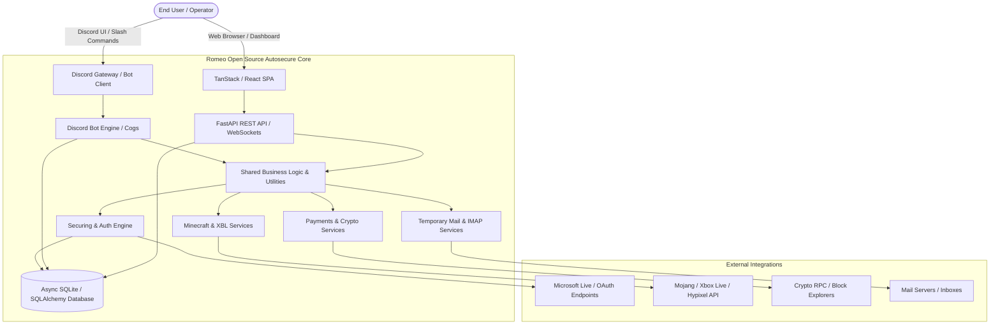

# Architecture Specification — Romeo Open Source Autosecure

**Project**: Romeo Open Source Autosecure  
**Repository**: [RomeoXLover/romeo-open-source-autosecure](https://github.com/RomeoXLover/romeo-open-source-autosecure)  
**Maintainer**: Romeo  

---

## 1. System Topology



---

## 2. Directory Layout & Module Responsibilities

```
romeoopen/
├── config/             # Environment, application constants, global settings
├── database/           # SQLite schema, async connection manager, repository patterns
├── mail/               # Temporary email client, inbox polling, verification code parser
├── minecraft/          # Mojang UUID, skin, capes, Hypixel stats, Xbox Live tokens
├── payments/           # Crypto payment gateways (BTC, ETH, SOL, USDT) and digital store webhooks
├── securing/           # Microsoft account authentication, alias rotation, 2FA setup, recovery
│   ├── auth/           # OAuth token retrieval, session cookies, lock checking
│   └── utils/          # Subroutines for proofs, family removal, pass reset, OGI lookups
├── shared/             # Cross-cutting concerns: TOTP generator, Discord embed builders, logging
├── ui/                 # Discord component interactions
│   ├── buttons/        # Dynamic button handlers (tickets, details, inbox, TOTP)
│   └── modals/         # Discord form inputs (bulk codes, credentials, settings)
├── cogs/               # Discord bot command modules (admin, auth, autobuy, general, stats)
├── bot.py              # Discord bot entrypoint, lifecycle events, and task runners
└── web/                # High-performance dashboard & REST API (Phase 7 — Built at end)
    ├── app.py          # FastAPI application factory and middleware
    ├── routers/        # Modular API endpoints (accounts, bot, commands, emails, stats)
    └── src/            # 3D Prismatic Glassmorphic Web App (TanStack Router, Vite, Tailwind)
```

---

## 3. Data Architecture & Database Models

The persistence layer uses async SQLite (`aiosqlite`) via SQLAlchemy 2.0 ORM with WAL mode enabled for high concurrency:

1. **`accounts`**:
   - `id` (INTEGER PRIMARY KEY)
   - `email` (VARCHAR, UNIQUE)
   - `password` (VARCHAR)
   - `recovery_code` (VARCHAR)
   - `totp_secret` (VARCHAR)
   - `uuid` (VARCHAR, NULLABLE)
   - `username` (VARCHAR, NULLABLE)
   - `capes` (JSON / TEXT)
   - `hypixel_stats` (JSON / TEXT)
   - `status` (VARCHAR: 'secured', 'pending', 'error', 'locked')
   - `created_at`, `updated_at` (TIMESTAMP)

2. **`settings`**:
   - Key-value store for runtime bot configuration, guild preferences, and webhooks.

3. **`shares`**:
   - Temporary public and private view tokens for sharing secured account details safely.

---

## 4. Concurrency & Performance Guardrails

- All network requests use `httpx.AsyncClient` or `aiohttp.ClientSession` with connection pooling, timeouts, and exponential backoff retry policies.
- Background jobs (autobuy polling, ban checking) run inside isolated asyncio Tasks to prevent blocking the Discord heartbeat.
- The web dashboard uses Server-Sent Events (SSE) or WebSockets for real-time status updates without polling overhead.
